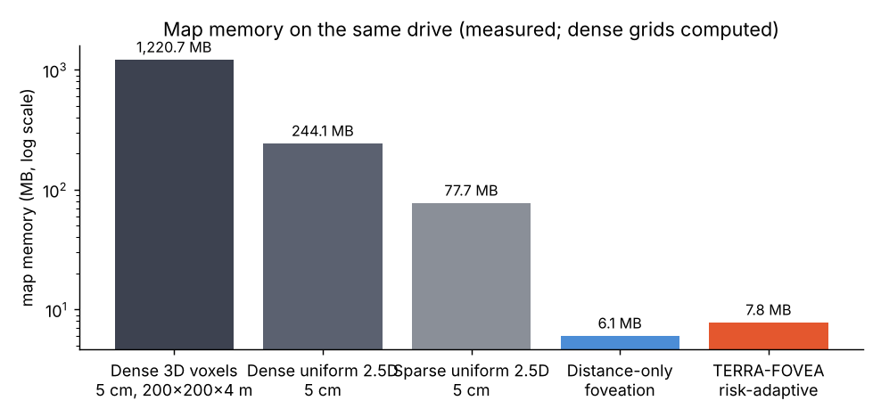
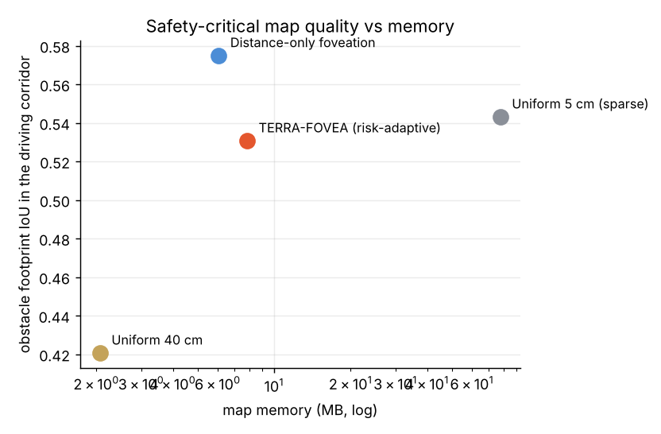
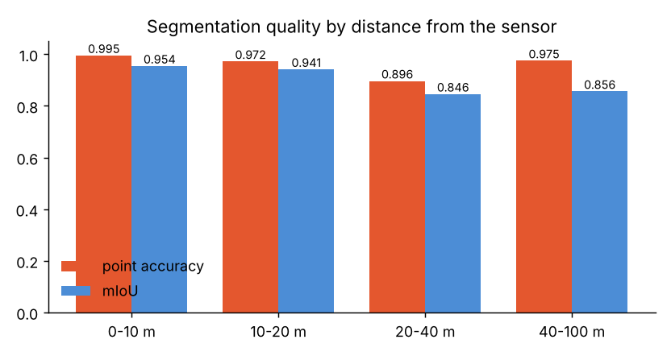
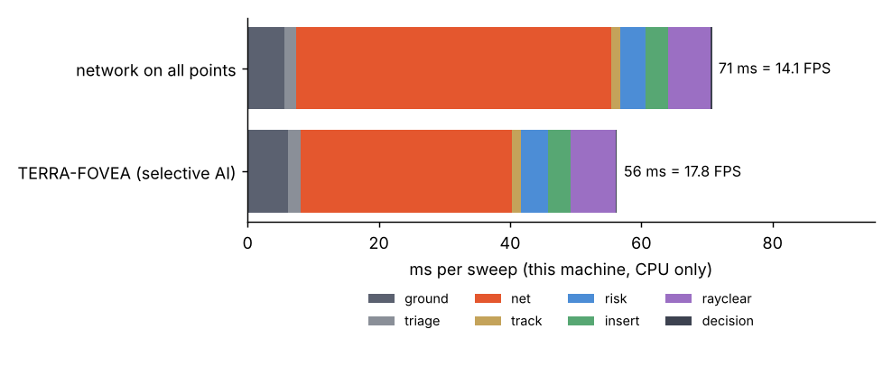

# TERRA-FOVEA: measured results

Sequence: `/home/claude/terra-fovea/data/gauntlet` (240 sweeps, ~84,504 points per sweep). **Simulated LiDAR data** (python/sim.py): all accuracy numbers below are on simulation.
Latency is wall-clock on the machine that ran this script, CPU only. Regenerate with `python python/evaluate.py`.

## 1. Memory

| Representation | Cells (mean) | Memory | vs TERRA-FOVEA |
|---|---:|---:|---:|
| Dense 3D voxel grid, 5 cm, 200 x 200 x 4 m (computed, 1 byte/voxel) | 1,280,000,000 | 1220.70 MB | 156x |
| Dense uniform 2.5D grid, 5 cm, 200 x 200 m (computed, 16 B/cell) | 16,000,000 | 244.14 MB | 31.2x |
| Sparse uniform 2.5D, 5 cm (measured, same engine) | 5,034,271 | 77.68 MB | 9.9x |
| Distance-only foveation (measured) | 340,294 | 6.06 MB | 0.77x |
| **TERRA-FOVEA risk-adaptive (measured)** | **456,675** | **7.83 MB** | 1x |
| Uniform 40 cm (measured) | 78,660 | 2.07 MB | 0.26x |

Peak map memory of TERRA-FOVEA over the drive: 8.53 MB. Frame workspace (scratch buffers, not the map): 14.2 MB.

## 2. Safety-critical map quality vs memory

Obstacle footprint of the map compared with 5 cm ground truth, inside the driving corridor (2.5 to 40 m ahead, 5 m wide). "Falsely blocked" is free corridor area the map marks as occupied.

| Variant | Memory | Corridor IoU | Corridor precision | Corridor recall | Falsely blocked | Whole-map IoU (60 m) |
|---|---:|---:|---:|---:|---:|---:|
| Uniform 5 cm (sparse) | 77.68 MB | 0.543 | 0.817 | 0.639 | 0.03 m2 | 0.921 |
| Uniform 40 cm | 2.07 MB | 0.421 | 0.431 | 0.857 | 2.64 m2 | 0.454 |
| Distance-only foveation | 6.06 MB | 0.575 | 0.704 | 0.730 | 0.57 m2 | 0.602 |
| TERRA-FOVEA (risk-adaptive) | 7.83 MB | 0.531 | 0.782 | 0.618 | 0.15 m2 | 0.730 |

## 3. Segmentation

| Class | drivable | terrain | structure | pole | vegetation | vehicle | person | mIoU |
|---|---:|---:|---:|---:|---:|---:|---:|---:|
| IoU, selective AI | 0.960 | 0.944 | 0.988 | 0.979 | 0.916 | 0.980 | 0.864 | **0.947** |
| IoU, network on all points | 0.992 | 0.984 | 0.991 | 0.985 | 0.916 | 0.979 | 0.845 | 0.956 |

| Distance band | 0-10 m | 10-20 m | 20-40 m | 40-100 m |
|---|---:|---:|---:|---:|
| Point accuracy | 0.995 | 0.972 | 0.896 | 0.975 |
| mIoU | 0.954 | 0.941 | 0.846 | 0.856 |
| Points evaluated | 12,095,734 | 5,917,913 | 1,638,584 | 625,156 |

Moving-object points (tracker): precision 0.984, recall 0.834.

## 4. Latency

| Stage (ms) | ground | triage | network | tracking | risk+resample | map update | ray clearing | decision | total | FPS |
|---|---:|---:|---:|---:|---:|---:|---:|---:|---:|---:|
| TERRA-FOVEA (selective AI) | 6.1 | 2.0 | 32.2 | 1.4 | 4.0 | 3.5 | 6.8 | 0.3 | 56.3 | 17.8 |
| network on all points | 5.5 | 1.8 | 48.1 | 1.4 | 3.8 | 3.4 | 6.5 | 0.2 | 70.8 | 14.1 |
| uniform 5 cm grid | 5.8 | 1.9 | 30.2 | 1.4 | 6.1 | 4.1 | 9.0 | 0.3 | 58.7 | 17.0 |

Selective AI sends 59% of the points to the network (vs 100%), network time 32.2 ms vs 48.1 ms, mIoU 0.947 vs 0.956.

## 5. Dynamic objects: ghost removal

Occupied map area left where a moving object used to be (and nothing is now).

| | mean ghost area | peak ghost area |
|---|---:|---:|
| Ray clearing ON | 0.461 m2 | 2.060 m2 |
| Ray clearing OFF | 16.504 m2 | 37.223 m2 |

## 6. Hazards a 2D grid cannot represent

| Hazard | Truth | Result |
|---|---|---|
| pothole at x=30 m | 20 cm deep | flagged at 6.0 m range |
| trench at x=86 m | 55 cm deep | flagged at 6.9 m range |
| pothole at x=52 m | 35 cm deep | flagged at 10.0 m range |
| gantry | clearance 3.40 m | measured 3.38 m; obstacle cells wrongly placed on the road under it: 7 |
| boom | clearance 1.35 m | measured 1.36 m; obstacle cells wrongly placed on the road under it: 107 |

Negative-obstacle false alarms: 2.815 m2 of map on average.

## 7. Decision layer log

| Sweep | Ego x (m) | State | Reason |
|---:|---:|---|---|
| 0 | 0.0 | CLEAR | corridor clear |
| 13 | 7.5 | CAUTION | vehicle #10 crossing path, time to conflict 3.0 s |
| 16 | 9.1 | CLEAR | corridor clear |
| 43 | 22.3 | STOP | vehicle 2.2 m ahead in path (0.9 m tall) |
| 44 | 22.7 | CLEAR | corridor clear |
| 46 | 23.6 | CAUTION | vegetation 20.9 m ahead in path (0.8 m tall) |
| 54 | 26.8 | CAUTION | overhead clearance 1.32 m, need 2.2 m, 25.9 m ahead |
| 56 | 27.6 | CAUTION | pole 25.4 m ahead in path (3.2 m tall) |
| 57 | 28.0 | STOP | negative obstacle 2.2 m ahead (confidence 1.00) |
| 58 | 28.4 | CAUTION | person #11 crossing path, time to conflict 3.2 s |
| 69 | 32.0 | CLEAR | corridor clear |
| 70 | 32.2 | CAUTION | person #11 crossing path, time to conflict 3.5 s |
| 71 | 32.5 | CLEAR | corridor clear |
| 77 | 33.8 | CAUTION | moving person in path, 12.2 m ahead |
| 83 | 35.1 | CLEAR | corridor clear |
| 84 | 35.3 | CAUTION | vehicle #45 crossing path, time to conflict 4.0 s |
| 85 | 35.5 | CLEAR | corridor clear |
| 91 | 36.7 | CAUTION | vehicle #32 crossing path, time to conflict 3.8 s |
| 102 | 38.9 | CLEAR | corridor clear |
| 103 | 39.1 | CAUTION | negative obstacle 18.1 m ahead (confidence 0.45) |
| 110 | 40.6 | STOP | vehicle #65 crossing path, time to conflict 1.5 s |
| 113 | 41.4 | CAUTION | negative obstacle 15.8 m ahead (confidence 0.43) |
| 117 | 42.9 | STOP | vehicle #72 crossing path, time to conflict 1.0 s |
| 119 | 43.8 | CAUTION | negative obstacle 13.4 m ahead (confidence 0.43) |
| 127 | 48.3 | STOP | negative obstacle 9.0 m ahead (confidence 0.40) |
| 145 | 58.4 | CLEAR | corridor clear |
| 175 | 76.0 | CAUTION | overhead clearance 1.38 m, need 2.2 m, 20.9 m ahead |
| 178 | 77.6 | CAUTION | structure 30.8 m ahead in path (4.9 m tall) |
| 180 | 78.4 | CAUTION | overhead clearance 1.98 m, need 2.2 m, 9.7 m ahead |
| 184 | 80.0 | STOP | overhead clearance 1.98 m, need 2.2 m, 7.7 m ahead |
| 187 | 81.1 | CAUTION | overhead clearance 2.18 m, need 2.2 m, 19.2 m ahead |
| 188 | 81.5 | CAUTION | structure 26.1 m ahead in path (4.9 m tall) |
| 190 | 82.3 | CAUTION | overhead clearance 1.38 m, need 2.2 m, 14.7 m ahead |
| 206 | 89.5 | STOP | overhead clearance 1.36 m, need 2.2 m, 7.3 m ahead |
| 207 | 89.9 | CAUTION | vegetation 19.8 m ahead in path (0.3 m tall) |
| 209 | 90.7 | CAUTION | overhead clearance 1.98 m, need 2.2 m, 18.9 m ahead |
| 210 | 91.1 | CAUTION | pole 8.6 m ahead in path (4.3 m tall) |
| 213 | 92.1 | STOP | pole 7.2 m ahead in path (4.3 m tall) |
| 214 | 92.4 | CAUTION | overhead clearance 1.98 m, need 2.2 m, 16.6 m ahead |
| 215 | 92.8 | CAUTION | structure 17.0 m ahead in path (4.8 m tall) |
| 217 | 93.5 | CAUTION | overhead clearance 1.08 m, need 2.2 m, 18.5 m ahead |
| 218 | 93.9 | CAUTION | vehicle 17.1 m ahead in path (0.8 m tall) |
| 224 | 96.4 | CAUTION | overhead clearance 1.06 m, need 2.2 m, 14.8 m ahead |

## 8. Degraded sensor

30% random point dropout + 3 cm range noise: mIoU 0.940 (clean 0.947), corridor IoU 0.563 (clean 0.531), memory 7.76 MB, 22.2 FPS.

